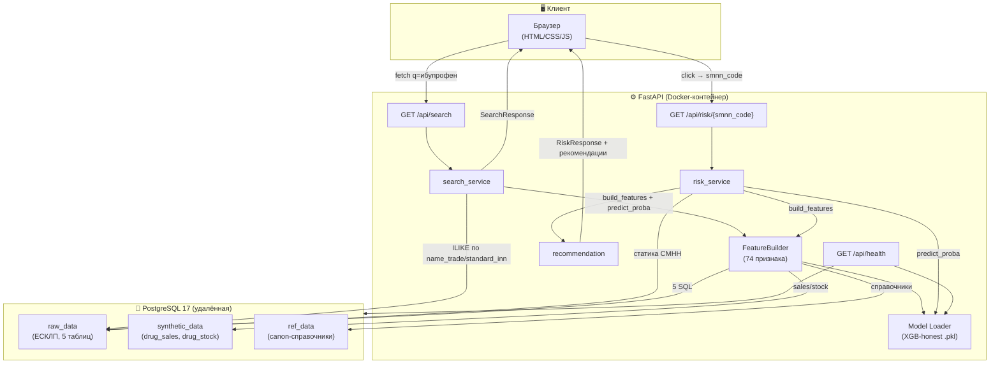

# 💊 Прогноз дефицита лекарственных средств

**Drug Deficit Predictor** — Веб-сервис для прогнозирования риска дефицита лекарственных препаратов на основе открытых данных реестра ЕСКЛП Минздрава РФ и ML-модели.

[](https://www.python.org/)
[](https://fastapi.tiangolo.com/)
[](https://www.postgresql.org/)
[](https://www.docker.com/)


## 📋 Оглавление

- [Описание](#-описание-проекта)
- [Архитектура](#-архитектура)
- [Быстрый старт](#-быстрый-старт)
- [API](#-api)
- [ML-модель](#-ml-модель)
- [Структура проекта](#-структура-проекта)
- [Функциональные возможности](#-функциональные-возможности)
- [Ограничения](#-ограничения-и-известные-проблемы)
- [Скриншоты](#-скриншоты)
- [Ссылки и ресурсы](#-ссылки-и-ресурсы)

---


## 📋 Описание проекта

Проект представляет собой веб-сервис, который позволяет пользователям получать прогноз риска дефицита для конкретного лекарственного препарата. Система анализирует исторические данные об остатках и продажах, учитывает характеристики препарата (ЖНВЛП, производитель, наличие аналогов) и выдает прогноз с рекомендациями по действиям.

### Целевая аудитория
- **Фармацевтические дистрибьюторы** — для оптимизации закупок
- **Аптечные сети** — для управления ассортиментом
- **Логистические отделы** — для планирования поставок
- **Государственные учреждения** — для мониторинга ЖНВЛП

### Технические задачи проекта
1. Создать ML-модель для классификации риска дефицита (3 класса: низкий/средний/высокий)
2. Разработать веб-интерфейс для взаимодействия с моделью
3. Интегрировать данные из реестра ЕСКЛП и синтетические данные об остатках/продажах
4. Обеспечить скорость ответа < 2 секунд на запрос

### Источники данных
1. **Реестр нормативно-справочной информации Минздрава РФ** (nsi.rosminzdrav.ru)
   - Лекарственные препараты (товарные позиции)
   - Справочник МНН
   - Единицы измерения
   - Группы взаимозаменяемости
   - Члены групп взаимозаменяемости

2. **Синтетические данные** 
   - Исторические остатки на складах (24 месяца)
   - Исторические продажи (24 месяца)

---


## 🏗 Архитектура



**Поток запроса:**
1. Пользователь вводит название → `GET /api/search?q=...`
2. Сервис ищет СМНН в `raw_data.drug_products` (ILIKE по `name_trade`/`standard_inn`)
3. Возвращает список форм с превью риска 
4. Клик по карточке → `GET /api/risk/{smnn_code}`
5. Сервис считает 74 признака (`feature_builder`), прогоняет через модель, генерирует рекомендации

**Технологический стек:**
| Компонент | Технология | Назначение |
|---|---|---|
| Бэкенд | **FastAPI 0.115+** | REST API, автодокументация |
| БД | **PostgreSQL 17** | Хранение данных (raw_data, synthetic_data, ref_data) |
| ML | **XGBoost 3.2 + scikit-learn 1.6** | Модель, OneHotEncoder |
| Данные | **pandas 2.2, numpy 2.2** | Обработка |
| Контейнеризация | **Docker + docker-compose** | Деплой |
| Фронт | **HTML/CSS/JS** | UI |

--- 


## 🚀 Быстрый старт

### Вариант 1: Docker (рекомендуется)

**Требования:** Docker Desktop (Windows/macOS) или Docker Engine (Linux) + Docker Compose v2.

```bash
# 1. Клонировать репозиторий
git clone https://github.com/GilArtem/drug-deficit-predictor.git
cd drug-deficit-predictor

# 2. Создать .env из шаблона и заполнить реальными кредами
cp .env.example .env
# Отредактировать .env: DB_HOST, DB_PORT, DB_USER, DB_PASSWORD, DB_NAME

# 3. Убедиться, что модели лежат в models/
ls models/
# Ожидаемо: xgboost_honest_v1.pkl, onehot_encoder_v1.pkl, metadata_v1.json

# 4. Собрать и запустить
docker compose up -d --build

# 5. Проверить
curl http://localhost:8000/api/health
```
Открыть в браузере: http://localhost:8000/

### Вариант 2: Локально (для разработки)

Требования: Python 3.10+, PostgreSQL 17

``` bash
# 1. Создать venv
python -m venv venv
# Windows:
venv\Scripts\activate
# Linux/macOS:
source venv/bin/activate

# 2. Установить зависимости
pip install -r requirements.txt

# 3. Настроить .env (как в варианте 1)
cp .env.example .env
# Отредактировать .env

# 4. Запустить uvicorn
uvicorn app.main:app --reload --host 0.0.0.0 --port 8000
```
--- 


## 🎯 API

**Все эндпоинты доступны с автодокументацией в Swagger UI:** http://localhost:8000/docs

- GET /api/health

Проверка статуса сервиса (БД + модель + FeatureBuilder).

Ответ 200:

``` json
{
  "status": "ok",
  "app": "Drug Deficit Predictor",
  "version": "1.0.0",
  "components": {
    "database": {"status": "ok", "server_version": "17.9", "latency_ms": 24.5},
    "model": {"status": "ok", "model_type": "XGBClassifier", "n_features": 74, "classes": [0, 1, 2]},
    "feature_builder": {"status": "ok", "n_features": 74, "atc_groups_loaded": 720}
  }
}
```

- GET /api/search?q=...&limit=20&offset=0

Поиск препаратов по названию (торговое или МНН).

Пример: GET /api/search?q=ибупрофен&limit=5

Ответ:

``` json
{
  "total": 40,
  "limit": 5,
  "offset": 0,
  "items": [
    {
      "smnn_code": "21.20.10.141-000035-1-00080-0000000000000",
      "standard_inn": "ИБУПРОФЕН",
      "standard_form": "РАСТВОР ДЛЯ ВНУТРИВЕННОГО ВВЕДЕНИЯ",
      "standard_doze": "5 мг/мл",
      "trade_names": ["ИБУПРОФЕН-БИННОФАРМ", "Педеа"],
      "risk_preview": {"class": 0, "label": "Низкий", "probability": 0.9999}
    }
  ]
}
```

TODO (после Redis-кеша): сейчас риск считается для каждой карточки — до 30 секунд при limit=20. После кеширования — <1 сек.

- GET /api/risk/{smnn_code}

Полный прогноз для одного СМНН.

Ответ 200:

``` json
{
  "smnn_code": "21.10.51.121-000001-1-00120-0000000000000",
  "standard_inn": "ПОЛИВИТАМИНЫ+ПРОЧИЕ ПРЕПАРАТЫ",
  "standard_form": "СИРОП",
  "standard_doze": null,
  "trade_names": ["Фероглобин-В 12"],
  "risk": {
    "class": 1,
    "label": "Средний",
    "probability": 0.998,
    "probabilities": {"low": 0.0007, "medium": 0.998, "high": 0.0012}
  },
  "features_snapshot": {
    "products_count": 2,
    "producers_count": 1,
    "is_essential": false,
    "is_narcotic": false,
    "has_atc_substitutes": true,
    "avg_age": 17.14
  },
  "dynamic_data_available": true,
  "recommendations": [
    "Мало производителей (1): расширить пул поставщиков.",
    "Мониторить остатки еженедельно.",
    "Пересмотреть нормативы страхового запаса.",
    "Рассмотреть аналоги по ATC-группе как резерв.",
    "Препарат давно на рынке (17.1 лет): проверить актуальность регистрации."
  ]
}
```

Ответ 404: {"detail": {"error": "not_found", "detail": "СМНН ... не найден", "code": 404}}

TODO: добавить producers: list[str] в RiskResponse (полезно для UI).

---


## 🤖 Модель ML

### Тип задачи
**Многоклассовая классификация** (обучение с учителем)
3 класса риска: 0 — низкий, 1 — средний, 2 — высокий

### Данные
Источники:
- raw_data (схема raw_data) — 5 таблиц из реестра ЕСКЛП (~1.9 млн записей в drug_products).
- synthetic_data — сгенерированные продажи и остатки:
   1) drug_sales — 184,128 строк (7,672 СМНН × 24 месяца).
   2) drug_stock — 184,128 строк.
   3) drug_features — финальный ML-датасет (7,672 × 47).

Что было сделано (EDA + preprocessing):
- Отфильтровано actual = TRUE (604,349 строк).
- Нормализованы производители (producer_canon), страны (country_groups), единицы (unit_canon).
- Обработан code_atc (первый валидный, приведён к уровню 4, Unknown → Unkno).
- Даты: аномалии отсечены, avg_age / min_age / max_age.
- Агрегация по СМНН: 604,349 → 7,672 строк (сжатие 78.8×).

### Целевая переменная
deficit_risk (int: 0/1/2) — вычислена из синтетической динамики:

``` python 
if days_of_stock < 7:                                 return 2  # высокий
elif days_of_stock < 14 and sales_trend > 1.1:        return 1  # средний
elif days_of_stock < 30:                              return 1  # средний
else:                                                 return 0  # низкий
```
Распределение классов: 59.16% / 34.40% / 6.44%


### Признаки для модели
Статические (26):
- **Счётчики:** products_count, producers_count, trade_count, form_count, doze_count, reg_num_count, countries_count
- **Флаги:** is_essential (ЖНВЛП), is_narcotic, has_combined_atc, has_russian_producer
- **ATC:** atc_is_unknown, atc_substitutes_count, has_atc_substitutes, log_atc_substitutes_count
- **Даты:** avg_age, min_age, max_age
- **Логарифмы:** log_products_count, log_reg_num_count, log_trade_count, log_producers_count
- **Отношения:** products_per_producer, log_products_per_producer, reg_num_per_producer, trade_per_producer

Динамические (6):
- sales_last_month, current_stock, sales_trend, stock_trend, avg_sales_3m, avg_stock_3m

Категориальные → OneHot (42):
- atc_group_mode (15), country_group_mode (7), primary_unit_type (6), primary_unit_name (14)

Прокси-признаки (удалены из honest-модели):
- current_stock_days, stock_to_sales_ratio — детерминированно определяют target.


### Обученные модели
|Модель	|Признаки	|Recall кл.2	|Precision кл.2	|F1 кл.2	|Время|
|---|---|---|---|---|---|
|RF-full	|все 76	|1.0000	|0.9900	|0.9950	|0.80 сек|
|XGB-full	|все 76	|0.9798	|0.9798	|0.9798	|0.99 сек|
|RF-honest	|без 2 прокси	|0.9899	|0.7840	|0.8750	|0.77 сек|
|⭐XGB-honest 	|без 2 прокси	|0.9596	|0.9896	|0.9744	|1.72 сек|

Для деплоя выбран **XGB-honest**:
- Не использует прямые прокси target.
- Лучший баланс Precision/Recall.
- Кросс-валидация (RF-full, 5-fold): Recall = 0.9949 ± 0.0062.

---


## 🚀 Функциональные возможности

### Для пользователя
1. **Поиск препарата** по названию с автодополнением
2. **Получение прогноза** риска дефицита:
   - Категория риска (низкий/средний/высокий)
   - Вероятность риска (%)
   - Дней до предполагаемого дефицита
   - Текущие остатки и средние продажи
3. **Рекомендации по действиям**:
   - Сроки закупки
   - Рекомендуемый объем
   - Информация об аналогах
4. **Детальная информация** о препарате:
   - Производитель
   - ЖНВЛП/не ЖНВЛП
   - ATC-код

### Для администратора (не mvp-версия)
- Мониторинг списка препаратов с риском
- Экспорт отчетов (CSV)
- Обновление данных

---


## 📁 Структура проекта

```
drug-deficit-predictor/
├── app/
│   ├── config.py                 # Настройки из .env (pydantic-settings)
│   ├── main.py                   # FastAPI-приложение + lifespan
│   ├── core/
│   │   ├── db.py                 # Engine, пул соединений, health
│   │   ├── feature_builder.py    # 74 признака на лету
│   │   └── model_loader.py       # Загрузка XGB-honest + OneHotEncoder
│   ├── schemas/
│   │   └── response.py           # Pydantic-модели ответов API
│   ├── services/
│   │   ├── search_service.py     # Поиск препаратов (ILIKE + пагинация)
│   │   ├── risk_service.py       # Прогноз риска
│   │   └── recommendation.py     # Генерация рекомендаций
│   ├── routers/
│   │   ├── search.py             # GET /api/search
│   │   └── risk.py               # GET /api/risk/{smnn_code}
│   └── static/                   # UI (HTML/CSS/JS)
│       ├── index.html
│       ├── style.css
│       └── app.js
├── models/                       # Артефакты модели (gitignored)
│   ├── xgboost_honest_v1.pkl
│   ├── onehot_encoder_v1.pkl
│   └── metadata_v1.json
├── tests/                        # ⚠️ TODO: pytest (Шаг 14)
├── .dockerignore
├── .gitignore
├── Dockerfile
├── docker-compose.yml
├── requirements.txt
└── README.md
```

### Схемы PostgreSQL:

- raw_data — исходные данные ЕСКЛП (5 таблиц).
- synthetic_data — сгенерированные продажи/остатки/признаки.
- ref_data — справочники используемые для нормализации данных (producer_canon, country_groups, unit_canon).

--- 

## ⚠️ Ограничения и известные проблемы

### Важно!
- Синтетические данные. drug_sales и drug_stock сгенерированы искусственно. Модель предсказывает паттерны генератора, а не реальный рынок. В production нужны реальные данные из аптечных сетей / дистрибьюторов.

### 🔴 Критичные ошибки 
- Утечка (data leakage) в модели. Даже XGB-honest (без current_stock_days и stock_to_sales_ratio) содержит косвенные прокси (current_stock, avg_stock_3m, sales_last_month) — по ним можно частично восстановить target. Метрики завышены относительно «честной» оценки.

- scale_pos_weight не работает для мультикласса. В XGBoost scale_pos_weight применяется только к бинарной классификации. Для мультикласса нужен sample_weight при .fit() — сейчас не применён.

- Early stopping на test. best_iteration выбирался по test-выборке — лёгкая утечка. Корректно — train/val split внутри train.

### 🟡 Средние 
- ⚠️ TODO (Redis): поиск limit=20 занимает ~30 секунд (20 карточек × 5 SQL). Планируется Redis-кеш прогнозов (TTL 1 час). Сейчас — компромисс: with_risk_preview=True для limit<=10 (медленно, но красиво).

- ⚠️ TODO (производители в UI): в RiskResponse нет списка производителей. Планируется добавить producers: list[str].

- ⚠️ TODO (топ-риски): дашборд /api/top-risks (Топ-N рискованных препаратов) отложен. Планируется Redis + APScheduler.

- ⚠️ TODO (.env в Docker): сейчас config.py требует наличие .env — даже если переменные есть в os.environ. В Docker это приводит к монтированию .env как volume. Планируется fallback: если .env нет — читать из os.environ.

### 🟢 Низкие (nice to have)
- Sorting по релевантности: сейчас ORDER BY smnn_code — не по релевантности. Планируется ts_rank (PostgreSQL full-text search) или is_essential DESC.

- HTTPS / Nginx: сейчас uvicorn слушает 8000 напрямую. В production — Nginx + Let's Encrypt.

- Мониторинг: только /api/health. Планируется Prometheus + Grafana.

- CI/CD: ручной docker compose up. Планируется GitHub Actions.

--- 


### 📸 Скриншоты

TODO: добавить скриншоты после финальной версии UI.

Главная страница (поиск)

Результаты поиска «ибупрофен»

Модалка с прогнозом (риск + рекомендации)

---


## 📎 Ссылки и ресурсы

- **Источник данных:** [Реестр НСИ Минздрава](https://nsi.rosminzdrav.ru/dictionaries)
- **Репозиторий проекта:** [GitHub](https://github.com/GilArtem/drug-deficit-predictor)
- **Документация FastAPI:** https://fastapi.tiangolo.com
- **Документация scikit-learn:** https://scikit-learn.org
- **Swagger UI** (локально): http://localhost:8000/docs
- **XGBoost:** https://xgboost.readthedocs.io
- **scikit-learn:** https://scikit-learn.org

---


## 👥 Создатель

- **Разработчик:** Артем Гиль
- **e-mail:** gilart97@gmail.com

---

**Версия:** 1.0 (MVP)
